# Cosmic Diary — Full End-to-End System Flows

| Thuộc tính | Giá trị |
|---|---|
| Phiên bản | 0.1 |
| Ngày | 10/10/2026 |
| Trạng thái | BASELINED FOR DRAFTING |
| Phạm vi | Mobile APP-01–APP-10, Website WEB-01–WEB-10, Shared Platform |
| Tài liệu nguồn | Requirement Discovery, Decision Log, APP-01, APP-02 |

## 1. Mục đích

Tài liệu này là bản đồ luồng nghiệp vụ tổng thể, dùng để bảo đảm các đặc tả màn hình/module sau này không mâu thuẫn. Mỗi flow xác định actor, điểm vào, điều kiện, happy path, alternative/error path, trạng thái dữ liệu, API/domain liên quan và điểm đo analytics.

Chi tiết field/schema, acceptance criteria và UI state của từng module vẫn nằm trong tài liệu module tương ứng. Khi có mâu thuẫn, Shared Business Rule và Decision Log là nguồn chuẩn.

## 2. Actor Map

| Actor | Kênh | Quyền chính |
|---|---|---|
| Anonymous Web Visitor | Website | Xem nội dung, dùng công cụ Free, chia sẻ, tải App |
| Guest Mobile User | Mobile | Dùng Free, lưu cục bộ/cloud theo guest ID, không khôi phục đa thiết bị |
| Registered Free User | Mobile | Đồng bộ tài khoản, Free entitlement |
| Premium User | Mobile | Premium entitlement hợp lệ từ store/backend |
| Writer | CMS | Tạo/sửa draft |
| Editor | CMS | Biên tập, preview, yêu cầu duyệt |
| Approver | CMS | Duyệt, schedule, publish, withdraw |
| Administrator | CMS | RBAC, cấu hình và vận hành |
| Support Agent | Internal | Tra cứu giới hạn, không đọc diary/note mặc định |
| Apple/Google IdP | External | Xác thực identity |
| Apple App Store/Google Play | External | Giao dịch, renewal, refund, revoke |
| AI Provider | External/Internal | Diễn giải có ràng buộc, không là nguồn chân lý |
| Search Engine/Social Platform | External | Crawl/index và preview/chia sẻ |

## 3. Context Diagram

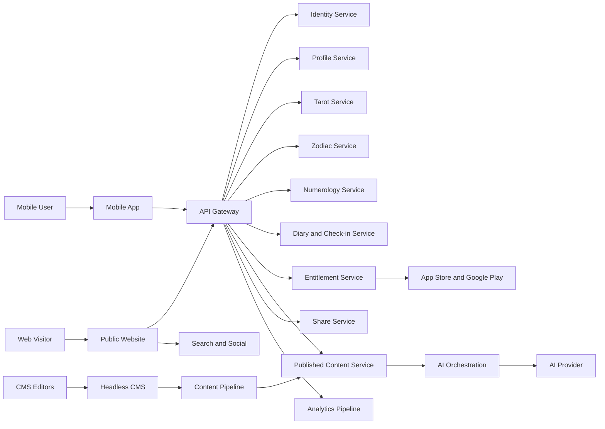

## 4. End-to-End Journey Map

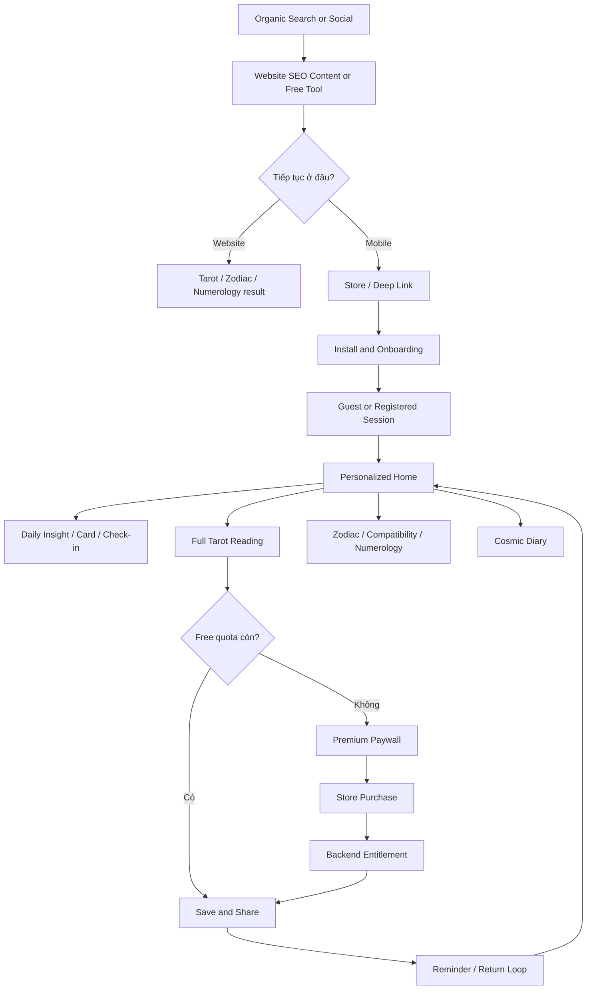

## 5. Master Flow Catalog

| Flow ID | Tên luồng | Module | Kênh | Ưu tiên MVP |
|---|---|---|---|---|
| E2E-001 | Acquisition Web-to-App | WEB-01/08/09 | Web → Mobile | Must |
| E2E-002 | Mobile First Run & Guest Onboarding | APP-01 | Mobile | Must |
| E2E-003 | Registered Login & Guest Merge | APP-01/09 | Mobile | Must |
| E2E-004 | Daily Home Loop | APP-02/08 | Mobile | Must |
| E2E-005 | Full Tarot Reading | APP-03 | Mobile | Must |
| E2E-006 | Free Tarot Web | WEB-02 | Website | Must |
| E2E-007 | Zodiac Discovery & Horoscope | APP-04/WEB-03 | Both | Must |
| E2E-008 | Zodiac Compatibility | APP-05/WEB-04 | Both | Phase 1.1 |
| E2E-009 | Numerology Life Path | APP-06/WEB-05 | Both | Phase 1.1 |
| E2E-010 | Cosmic Diary & Mood History | APP-07 | Mobile | Must-lite |
| E2E-011 | Notification & Streak Return Loop | APP-08 | Mobile | Must-lite |
| E2E-012 | Profile, Privacy & Account Deletion | APP-09 | Mobile | Must |
| E2E-013 | Subscription Purchase | APP-10 | Mobile | Must |
| E2E-014 | Restore, Renewal, Refund & Revoke | APP-10 | Mobile/Backend | Must |
| E2E-015 | Tarot Knowledge & Blog SEO | WEB-06/07/09 | Website | Must |
| E2E-016 | Content Authoring to Publish | WEB-10/Shared | CMS | Must |
| E2E-017 | AI Interpretation with Safety Fallback | Shared AI | Shared | Must |
| E2E-018 | Result Sharing & Revocation | APP-03/05/06, WEB tools | Both | Must-lite |
| E2E-019 | Analytics & Consent | All | Shared | Must |
| E2E-020 | Incident Content Withdrawal | CMS/Shared | Shared | Must |

## 6. E2E-001 — Acquisition Web-to-App

| Trường | Nội dung |
|---|---|
| Primary Actor | Anonymous Web Visitor |
| Entry | Search result, social post, campaign link, direct URL |
| Preconditions | Public page indexable/published; campaign link hợp lệ |
| Success Outcome | Store visit hoặc app open/install được attribution |
| Main Flow | Landing/tool page → nhận giá trị → CTA tải App → smart routing theo OS → store/deep link → first open → attribution recorded |
| Alternative | Desktop: hiển thị QR + gửi link; app đã cài: universal/app link mở route tương ứng |
| Exceptions | Không nhận biết OS, store unavailable, invalid campaign, deferred deep link hết hạn |
| Privacy | Không fingerprint; analytics theo consent và nền tảng cho phép |

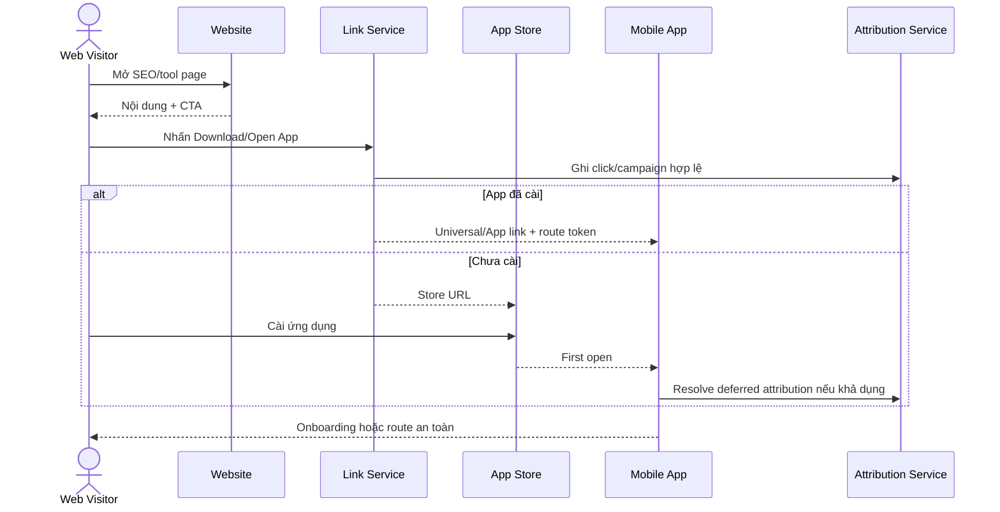

Quy tắc: deep link không được bỏ qua age/legal consent, authentication, entitlement hoặc authorization.

## 7. E2E-002 — Mobile First Run & Guest Onboarding

Nguồn chi tiết: `mobile-app/01-APP-01-Authentication-and-Onboarding.md`.

Main flow: Splash → Intro → 18+/Legal → Guest → Birth Profile → Interests → Notification Primer → Complete → Home.

Alternative: Apple/Google thay Guest; bỏ qua giờ/nơi sinh, sở thích hoặc notification; resume bước dang dở.

Error: legal content không tải, guest creation timeout, ngày sinh không hợp lệ, provider bị hủy, profile save lỗi.

Postcondition: session hợp lệ, consent receipt, onboarding version và profile tối thiểu tồn tại.

## 8. E2E-003 — Registered Login & Guest Merge

Main flow: Guest chọn Link Account → social authorization → backend verify → direct upgrade hoặc merge plan → user xác nhận → merge idempotent → phát hành registered session.

Merge policy:

- Server field thắng khi xung đột.
- Collection item không trùng được union.
- Entitlement chỉ lấy từ store/backend được xác thực.
- Guest session chỉ bị vô hiệu sau commit.
- Merge có audit và khả năng resume.

## 9. E2E-004 — Daily Home Loop

Nguồn chi tiết: `mobile-app/02-APP-02-Home-and-Daily-Cosmic-Insight.md`.

Main flow: Home aggregation → Daily Insight → check-in → Card of the Day → quick action → streak/reminder → quay lại ngày sau.

Hệ thống dùng một `canonical_daily_context` chung cho content, card, check-in, quota và streak.

## 10. E2E-005 — Full Tarot Reading trên Mobile

### 10.1 Screen flow

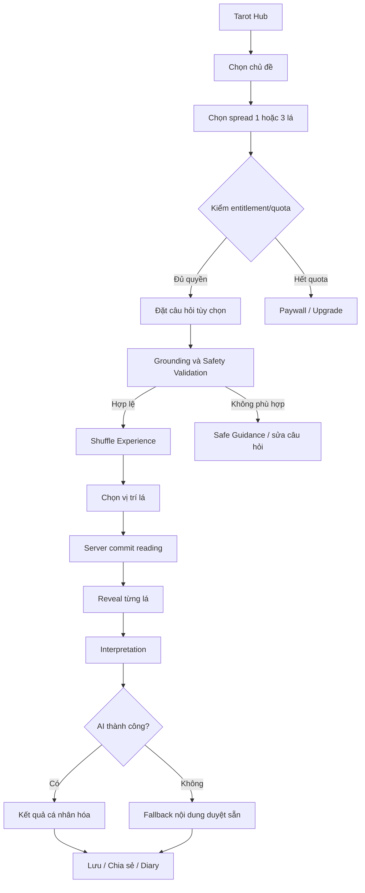

### 10.2 Use case

| Trường | Nội dung |
|---|---|
| Primary Actor | Guest/Free/Premium User |
| Preconditions | Session hợp lệ; deck/spread active; entitlement quyết định được |
| Trigger | Chọn bắt đầu trải bài |
| Main Flow | Chọn topic/spread → kiểm quota → nhập câu hỏi tùy chọn → safety validate → server tạo reading và card assignments → reveal → compose interpretation → lưu history → trừ quota thành công một lần |
| Alternative A | Không nhập câu hỏi: dùng topic prompt đã duyệt |
| Alternative B | AI timeout/unsafe: fallback theo card + spread + topic |
| Alternative C | App đóng sau commit: resume reading bằng reading ID |
| Exception | Hết quota, deck unavailable, duplicate commit, content withdrawn, AI failure |
| Postconditions | Reading immutable có deck/content/prompt version; quota ledger nhất quán |

### 10.3 Quy tắc cốt lõi

- Randomization và assignment chạy server-side bằng CSPRNG; animation shuffle không quyết định kết quả.
- Reading chỉ commit một lần bằng idempotency key.
- 1-card có vị trí `focus`; 3-card MVP dùng `past/present/future`.
- MVP chỉ `upright` theo DEC-007.
- Câu hỏi về tự hại, y tế, pháp lý, tài chính hoặc quyết định chắc chắn phải qua safety route, không tạo lời khuyên nguy hiểm.
- Quota được reserve/consume theo ledger; lỗi trước commit không trừ lượt, lỗi AI sau commit vẫn có fallback và được xem là reading hoàn thành.
- Kết quả lưu card IDs, spread version, content version, prompt version và model policy version.

### 10.4 System sequence

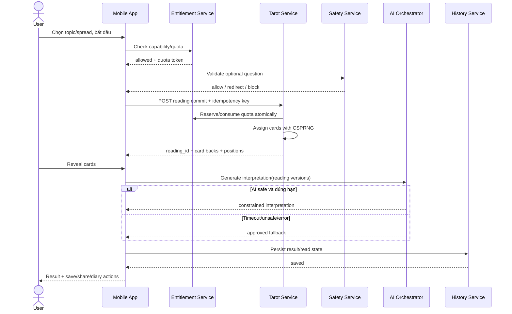

## 11. E2E-006 — Free Tarot Online trên Website

Flow giống Tarot Mobile về rule/card assignment nhưng khác state và conversion:

- Anonymous session dùng signed anonymous token/cookie theo privacy policy.
- Không lưu history cloud trong MVP.
- Giới hạn abuse theo session/network signals hợp lệ, không dùng fingerprint trái phép.
- Kết quả có URL share hoặc share image đã làm sạch.
- CTA App xuất hiện sau khi đã trả đủ giá trị, không khóa kết quả đã hứa.
- Web UI server-render/static shell cho SEO; thao tác draw là client interaction gọi API.

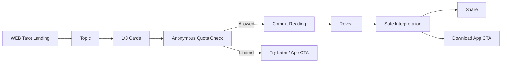

## 12. E2E-007 — Zodiac Discovery & Horoscope

### Main flow

1. User mở danh sách 12 cung hoặc cung cá nhân.
2. Hệ thống xác định sign từ profile/date nếu có; Web cho chọn thủ công.
3. User xem profile cung và horoscope ngày.
4. Có thể đổi ngày trong phạm vi nội dung đã publish; tuần/tháng chỉ hiển thị khi feature flag bật.
5. User chia sẻ nội dung đã làm sạch hoặc đi tới Compatibility.

### Rules

- Sun sign dùng shared boundary table có version.
- Không tự suy đoán sign nếu thiếu ngày sinh.
- Cusp được xử lý theo bảng ngày MVP; không tuyên bố birth chart chính xác.
- Horoscope phải Published, theo locale/effective date/segment/version.
- Web detail có canonical URL, metadata, structured data hợp lệ và internal links.
- App có cache ngày hiện tại; Web CDN phải purge khi withdraw.

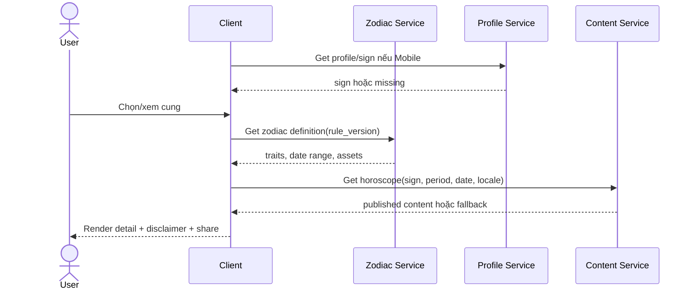

## 13. E2E-008 — Zodiac Compatibility

### Main flow

Chọn cung A → chọn cung B → normalize cặp theo matrix version → lấy score tổng và ba chiều Love/Friendship/Communication → hiển thị giải thích → lưu trên Mobile tùy chọn → chia sẻ bản làm sạch.

### Rules

- MVP/Phase 1.1 dùng ma trận Sun-sign 12x12 do biên tập duyệt.
- `A+B` và `B+A` có cùng score; copy có thể điều chỉnh ngôi xưng nhưng không đổi logic.
- Score không phải xác suất thành công và phải có disclaimer.
- Không tự sinh score bằng AI. AI chỉ được diễn đạt từ structured factors đã duyệt.
- Matrix version được lưu cùng result/share.

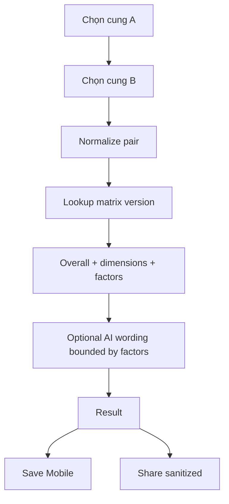

## 14. E2E-009 — Numerology Life Path

### Main flow

Nhập ngày sinh → validate 18+ nếu Mobile account creation context → chuẩn hóa digits → cộng/reduce theo Pythagorean → giữ master numbers 11/22/33 theo version rule → trả Life Path → diễn giải từ content đã duyệt → optional save/share.

### Formula baseline

- Cộng tất cả chữ số của ngày sinh hợp lệ.
- Rút gọn tổng tới một chữ số, ngoại trừ 11, 22, 33 nếu rule version cấu hình giữ master number.
- Ví dụ 28/07/1992: `2+8+0+7+1+9+9+2 = 38 → 3+8 = 11`, kết quả 11.
- Không tính Name Number trong MVP; không thu tên chỉ vì công cụ Life Path.

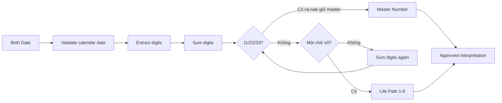

## 15. E2E-010 — Cosmic Diary & Mood History

### Main flow

Mở Diary → xem calendar/timeline → tạo entry → chọn mood, nhập note tùy chọn, liên kết reading tùy chọn → lưu encrypted → xem/sửa/xóa → thống kê theo khoảng thời gian.

### Alternative/error flows

- Offline: lưu local encrypted queue, sync idempotent khi có mạng.
- Conflict: không tự merge note text; hiển thị bản local/server và cho chọn.
- Entry linked reading bị xóa: giữ entry nhưng bỏ liên kết, không xóa note.
- User xóa entry: soft-delete sync để truyền tombstone; purge theo retention.
- No data: hướng dẫn tạo entry, không hiển thị biểu đồ gây hiểu nhầm.

### Privacy rules

- Diary/note/mood là dữ liệu riêng tư; không hiển thị trong support/admin mặc định.
- Không gửi nội dung note/mood vào analytics hoặc AI nếu user chưa chủ động yêu cầu tính năng tương ứng.
- Export/delete theo account privacy flow.
- Log không chứa note body.

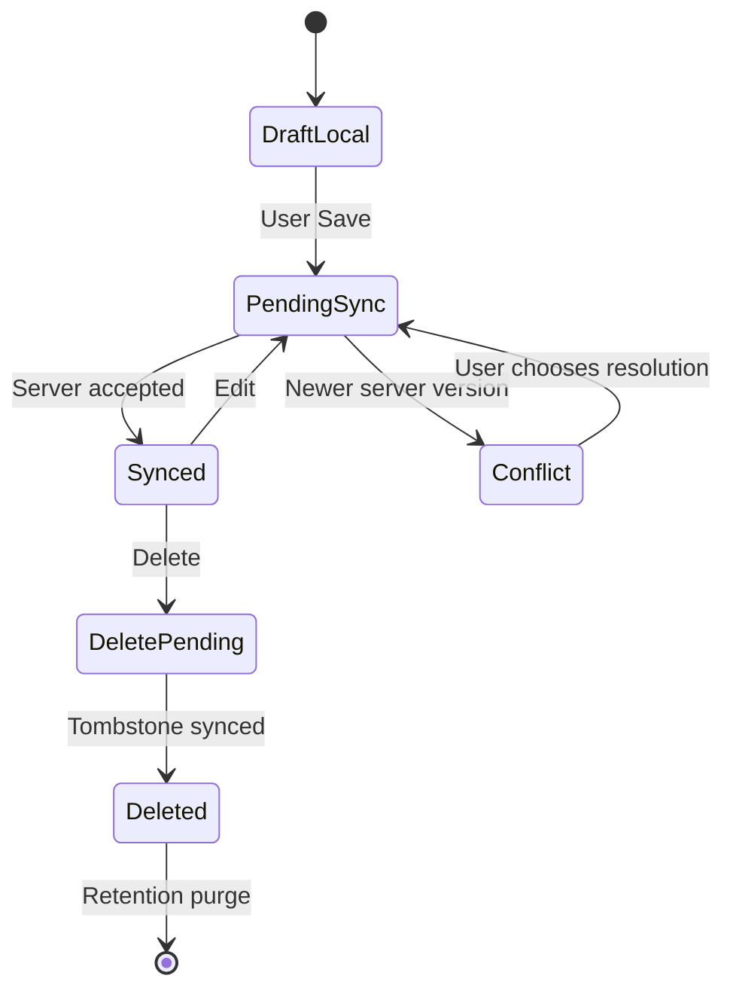

## 16. E2E-011 — Notification & Streak Return Loop

### Flow

User opt-in category → backend lưu preference/timezone/quiet hours → scheduler chọn eligible users → resolve template/content version → push provider → app nhận → deep link validator → route Home/feature → analytics delivery/open nếu được phép.

### Rules

- Service, engagement và marketing tách consent.
- Quiet hours mặc định đề xuất 22:00–08:00 local.
- Không đưa mood, câu hỏi Tarot hoặc dữ liệu nhạy cảm vào push lock-screen.
- Deep link không bỏ qua auth/entitlement.
- Frequency cap remote-config; streak reminder không gửi nếu đã check-in.
- Push failure không thay đổi streak hoặc nghiệp vụ chính.

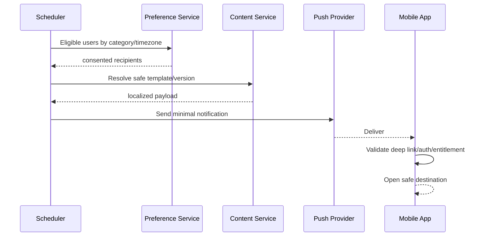

## 17. E2E-012 — Profile, Privacy & Account Deletion

### Profile/settings flows

- View/update birth profile and interests; changes tạo profile version mới.
- Notification preferences theo category.
- Privacy consent history, export request và delete request.
- Logout xóa token/cache nhạy cảm khỏi thiết bị nhưng không xóa account.

### Account deletion flow

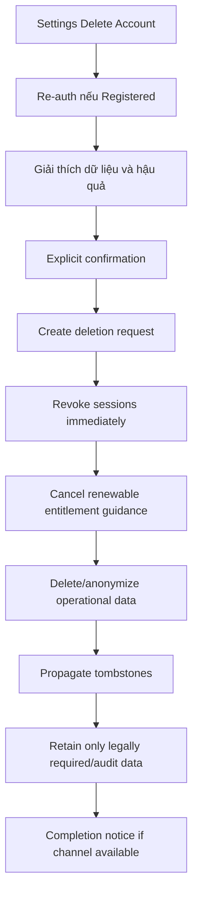

Rules:

- Xóa account không đồng nghĩa hủy subscription tại store; UI phải hướng dẫn rõ.
- Sessions bị revoke ngay sau xác nhận.
- Deletion job idempotent, auditable, có retry.
- Backup purge theo retention baseline; dữ liệu giữ lại phải tối thiểu và có căn cứ.
- Guest deletion không yêu cầu provider re-auth nhưng cần local confirmation và server token hợp lệ.

## 18. E2E-013 — Subscription Purchase

### Main flow

Paywall → chọn tháng/năm → lấy localized store product → store purchase sheet → transaction pending/success/cancel/fail → app gửi signed transaction/backend verify → entitlement active → UI refresh.

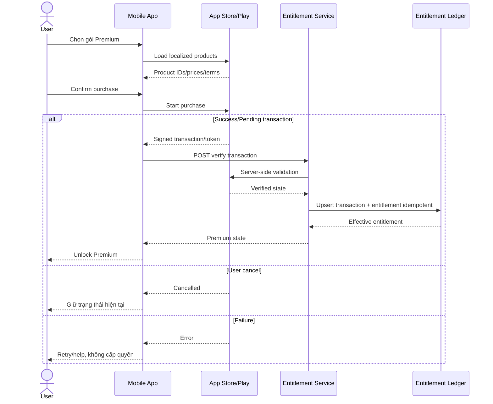

Rules:

- Giá/tiền tệ/renewal terms lấy từ store, không hard-code.
- Chỉ backend verification cấp entitlement; client receipt không đủ.
- Transaction ID unique; verify idempotent.
- Pending purchase không hiển thị như thất bại và chưa cấp quyền tới khi verified.
- Paywall có Restore Purchase, Terms, Privacy và quản lý subscription.

## 19. E2E-014 — Restore, Renewal, Refund & Revoke

### Restore

User chọn Restore → store query transactions → backend verify → map entitlement tới account → xử lý conflict nếu purchase đang thuộc account khác theo policy → refresh entitlement.

### Server notification lifecycle

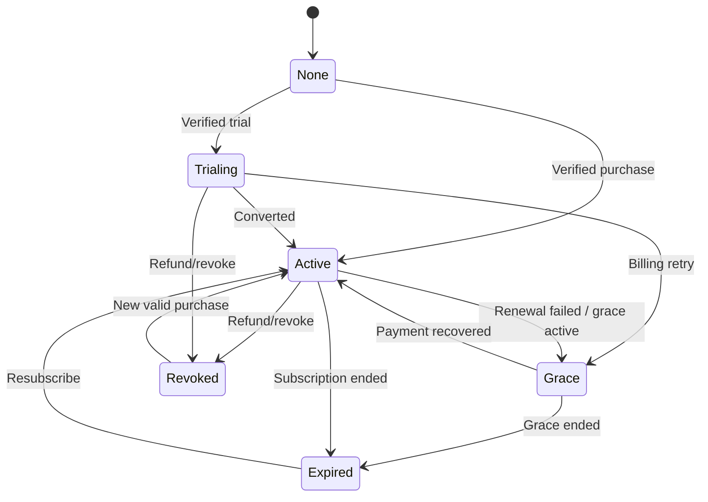

Rules:

- Effective entitlement được tính từ verified store events, không từ client clock.
- Notification webhook phải verify signature, deduplicate và có replay protection.
- Refund/revoke cập nhật quyền nhanh, lưu audit nhưng không xóa content user đã tạo trừ khi policy yêu cầu.
- Grace period hiển thị trạng thái rõ và tuân theo store.

## 20. E2E-015 — Tarot Knowledge & Blog SEO

### Flow

Search crawl/user visit → canonical content page → render server-side metadata/content/schema → internal links → related content → social share → optional App CTA.

Rules:

- Mỗi Tarot card có một canonical slug/locale; đổi slug phải redirect 301.
- Draft, preview, thin/private pages là noindex.
- Structured data phải phản ánh nội dung nhìn thấy, không tạo rating/review giả.
- Pagination/category/tag có canonical/index rules riêng.
- Search nội bộ không mặc định index.
- Withdraw content trả 410 hoặc redirect theo quyết định SEO, đồng thời purge CDN.

## 21. E2E-016 — Content Authoring to Publish

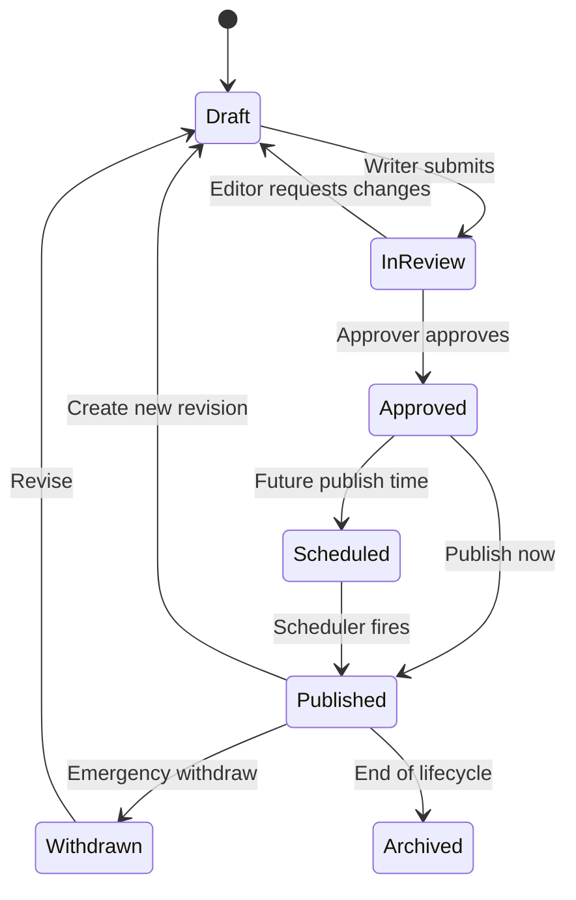

### Publish sequence

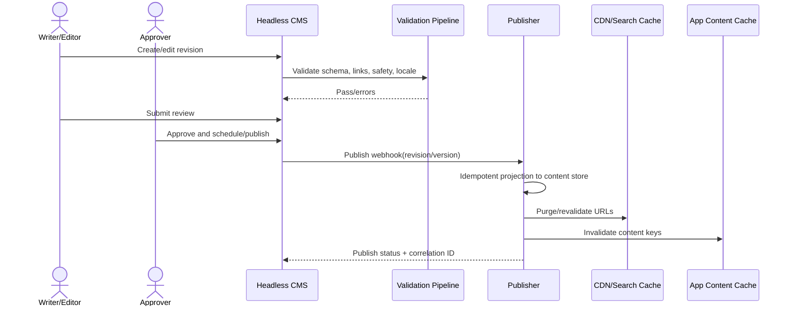

Rules:

- Writer không publish; Approver hoặc Admin mới publish.
- Published revision immutable; sửa tạo revision mới.
- Mỗi nội dung có ID ổn định và version tăng đơn điệu.
- Validation kiểm tra schema, link, unsafe claim, missing locale/fallback và asset rights metadata.
- Publish webhook idempotent; lỗi downstream có retry/dead-letter/alert.

## 22. E2E-017 — AI Interpretation with Safety Fallback

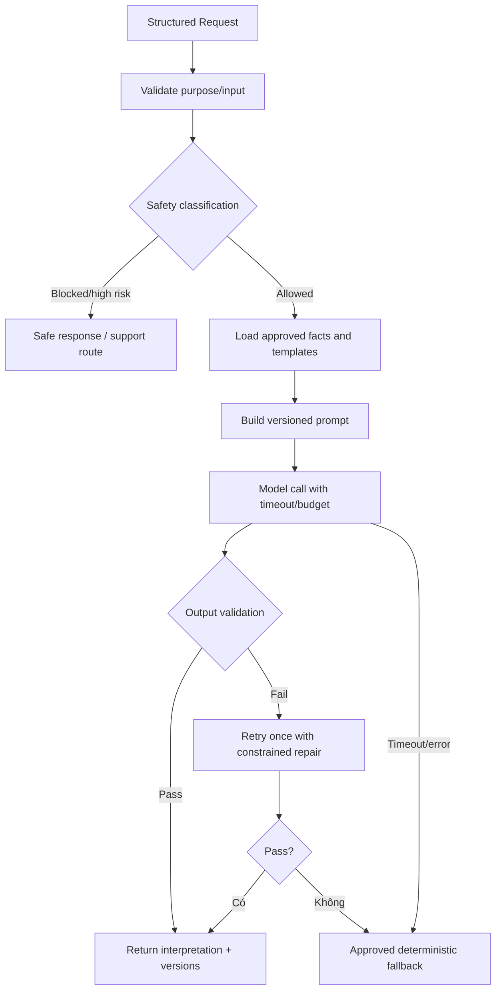

Rules:

- AI không tạo card assignment, compatibility score, zodiac sign hoặc numerology number.
- Prompt chỉ nhận dữ liệu tối thiểu; không gửi raw diary/birth place nếu không cần và chưa consent.
- Output validator chặn medical/legal/financial certainty, fear-based coercion và harmful content.
- Một retry có kiểm soát; sau đó fallback để bảo đảm availability/cost.
- Lưu prompt template version, knowledge/content version, model policy và safety outcome; không log secret hoặc PII thô.
- User-facing copy ghi đây là nội dung tham khảo/giải trí và không thay thế chuyên gia.

## 23. E2E-018 — Result Sharing & Revocation

### Flow

User chọn Share → preview sanitized payload → tạo share artifact/token → native share hoặc copy URL → recipient mở public page/image → owner có thể revoke → link hết hạn sau 30 ngày.

Rules:

- Không bao gồm tên, ngày sinh, nơi sinh, mood, diary note hoặc câu hỏi riêng tư theo mặc định.
- Share token ngẫu nhiên, không tuần tự, không chứa user ID.
- Public page noindex trừ khi sản phẩm chủ động thiết kế indexable templates không cá nhân.
- Revoked/expired trả trạng thái không còn khả dụng, không tiết lộ lý do hay owner.
- Social preview dùng asset/text đã làm sạch.

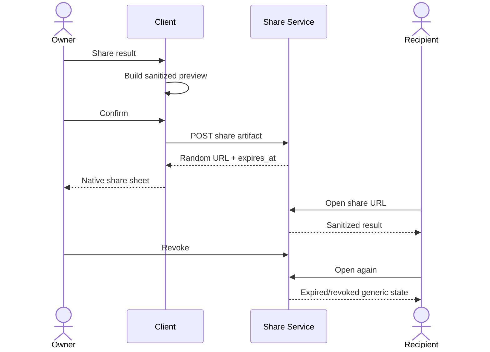

## 24. E2E-019 — Analytics & Consent

### Flow

Client reads consent → event SDK filters allowlist → remove/transform disallowed fields → enqueue → ingest validates schema/version → route storage by purpose/retention → dashboards/experiments use aggregate data.

Rules:

- Essential operational telemetry tách khỏi product/marketing analytics.
- Analytics/marketing opt-in mặc định tắt nếu policy áp dụng.
- Không gửi raw birth data, mood, diary note, Tarot question, provider token hoặc email.
- Event taxonomy/version là hợp đồng; unknown fields bị reject/quarantine.
- Consent withdrawal dừng future collection và xử lý dữ liệu cũ theo policy.
- Attribution không vượt consent và platform policy.

## 25. E2E-020 — Incident Content Withdrawal

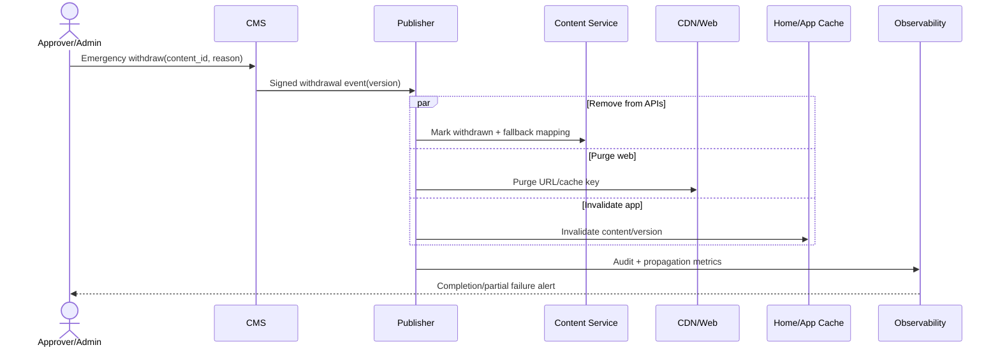

Rules:

- Emergency withdraw không xóa audit/revision.
- Clients gặp withdrawn content phải xóa cache item và dùng fallback hoặc unavailable state.
- Propagation có SLO đề xuất: API mới không trả content trong 5 phút; CDN purge trong 15 phút.
- Partial failure tạo alert và retry cho tới hoàn tất hoặc cần người xử lý.

## 26. Website Page Flow Map

| Page ID | Route mẫu | Entry | Primary CTA | Exit/Next |
|---|---|---|---|---|
| WEB-PAGE-001 | `/` | Direct/brand | Explore/Tải App | Tools, content, store |
| WEB-PAGE-002 | `/tarot` | Search/social | Bắt đầu Tarot | Reading flow |
| WEB-PAGE-003 | `/tarot/reading` | Tarot hub | Reveal | Result |
| WEB-PAGE-004 | `/tarot/result/:token?` | Reading/share | Share/Tải App | Social/store |
| WEB-PAGE-005 | `/zodiac` | Search/nav | Chọn cung | Zodiac detail |
| WEB-PAGE-006 | `/zodiac/:sign` | Search/hub | Xem horoscope | Period/compatibility |
| WEB-PAGE-007 | `/compatibility` | Search/nav | Tính tương hợp | Result/share |
| WEB-PAGE-008 | `/numerology/life-path` | Search/nav | Tính Life Path | Result/content |
| WEB-PAGE-009 | `/tarot/cards` | Search/nav | Chọn lá | Card detail |
| WEB-PAGE-010 | `/tarot/cards/:slug` | Search/library | Related/Reading | Internal links |
| WEB-PAGE-011 | `/blog` | Search/nav | Chọn bài | Article |
| WEB-PAGE-012 | `/blog/:slug` | Search/share | Related/Tải App | Internal links/store |
| WEB-PAGE-013 | `/download` | CTA/campaign | Store/QR | Store/App |
| WEB-PAGE-014 | `/privacy`, `/terms` | Footer/consent | N/A | Back |

## 27. Mobile Screen Flow Map

| Module | Screen range đề xuất | Entry | Success exit |
|---|---|---|---|
| APP-01 | APP-SCR-001–010 | First run/settings | Home/registered account |
| APP-02 | APP-SCR-011–015 | Home tab | Detail/check-in/module route |
| APP-03 | APP-SCR-016–023 | Home/quick action/history | Result/history/share |
| APP-04 | APP-SCR-024–027 | Home/tab/deep link | Horoscope/share |
| APP-05 | APP-SCR-028–030 | Quick action/zodiac | Compatibility result |
| APP-06 | APP-SCR-031–034 | Quick action/profile | Fortune profile/result |
| APP-07 | APP-SCR-035–040 | Diary tab/result CTA | Saved entry/statistics |
| APP-08 | APP-SCR-041–044 | Home/settings/push | Preference/streak/reward |
| APP-09 | APP-SCR-045–052 | Profile tab | Updated settings/account state |
| APP-10 | APP-SCR-053–057 | Paywall/settings | Entitlement/result |

## 28. Cross-Module State Dependencies

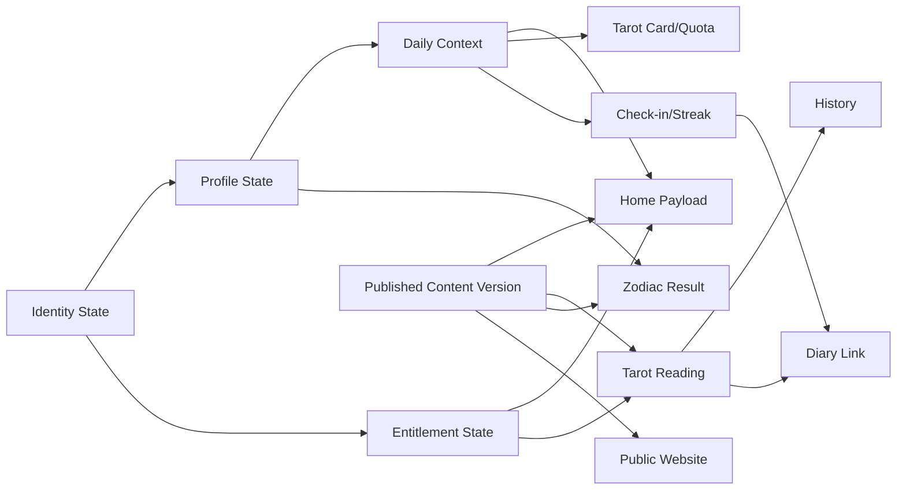

## 29. Global Error & Recovery Matrix

| Tình huống | UX bắt buộc | Data behavior | Recovery |
|---|---|---|---|
| Mất mạng | Hiển thị offline rõ, dùng cache hợp lệ | Không giả thành công server | Queue idempotent hoặc Retry |
| Session hết hạn | Re-auth/refresh không làm lộ data cũ | Giữ draft local an toàn | Refresh hoặc login |
| Partial backend failure | Section/function lỗi riêng | Không rollback phần độc lập đã commit | Retry scoped operation |
| Duplicate submit | Disable double action nhưng vẫn xử lý server-side | Idempotency returns same result | Return existing resource |
| Content withdrawn | Generic unavailable/fallback | Xóa cache bị thu hồi | Refetch version mới |
| AI timeout/unsafe | Không để màn vô hạn | Reading vẫn có structured data | Approved fallback |
| Payment pending | Trạng thái đang xử lý | Chưa tự cấp quyền | Reconcile/webhook/refresh |
| Merge conflict | Thông báo rõ và không mất dữ liệu | Server policy + audit | Resume/review |
| Unsupported client schema | Yêu cầu update hoặc bỏ section optional | Không crash | Version negotiation |

## 30. Global Acceptance Principles

Mọi flow/module chi tiết phải có test cho các nhóm sau:

1. Happy path.
2. Input không hợp lệ và boundary values.
3. Empty/no-content state.
4. Loading, timeout, retry và partial failure.
5. Offline và sync conflict nếu có dữ liệu ghi.
6. Guest/Free/Premium/expired entitlement.
7. Consent denied/withdrawn.
8. Accessibility: screen reader, focus, contrast, font scale, Reduce Motion.
9. Security: authorization, replay, tampering, rate limit, IDOR.
10. Privacy: PII/sensitive data không vào logs/analytics/share.
11. Idempotency và concurrency cho mọi create/commit/payment/merge.
12. Content/API version compatibility và emergency withdrawal.

## 31. Traceability tổng

| Business Goal | Flows | Modules | Shared Contracts |
|---|---|---|---|
| Tăng organic acquisition | E2E-001, 006, 007, 009, 015 | WEB-01–09 | Content, SEO, Analytics |
| Tăng activation Mobile | E2E-002, 003, 004 | APP-01/02 | Identity, Profile, Daily Context |
| Cung cấp giá trị Tarot | E2E-005, 006, 017, 018 | APP-03, WEB-02 | Tarot, AI Safety, Share |
| Tạo retention | E2E-004, 010, 011 | APP-02/07/08 | Check-in, Notification, Privacy |
| Tạo doanh thu | E2E-013, 014 | APP-10 | Entitlement, Store Validation |
| Vận hành nội dung nhất quán | E2E-016, 020 | WEB-10, All consumers | CMS, Versioning, Cache Invalidation |
| Bảo vệ người dùng/dữ liệu | E2E-012, 017, 019 | All | Consent, Safety, Retention, Access |

## 32. Thứ tự đặc tả module tiếp theo

1. APP-03 Tarot Reading.
2. Shared Tarot Domain Specification.
3. APP-04 Zodiac & Horoscope và Shared Zodiac.
4. APP-07 Diary, APP-08 Notifications, APP-10 Monetization.
5. APP-05 Compatibility, APP-06 Numerology, APP-09 Settings.
6. Website WEB-01–10 theo page flow map.
7. Shared API/Data/Analytics/NFR và Master RTM.

Thứ tự này ưu tiên dependency nghiệp vụ; không có nghĩa các đội phát triển không thể làm song song sau khi shared contract tương ứng đã baseline.

